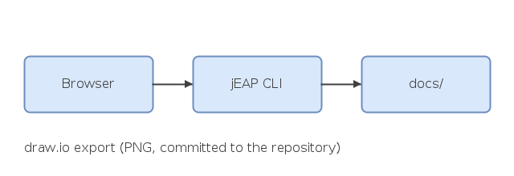

A committed draw.io export is shown as an ordinary image:

## Links

| Link                                                       | Rendered as                                      |
|------------------------------------------------------------|--------------------------------------------------|
| [Diagrams](../2-diagrams/diagrams.md)                      | `.md` rewritten to `.html`                       |
| [PlantUML section](../2-diagrams/diagrams.md#plantuml)     | with the fragment kept                           |
| [A generated chapter](../3-context/system-context-view.md) | broken here, ignored (exists on the doc service) |
| [jEAP on GitHub](https://github.com/jeap-admin-ch)         | external, unchanged                              |

Raw HTML is escaped, like on the doc service: <b>not bold</b>.

~~Strikethrough~~ and autolinks such as https://www.admin.ch work.
