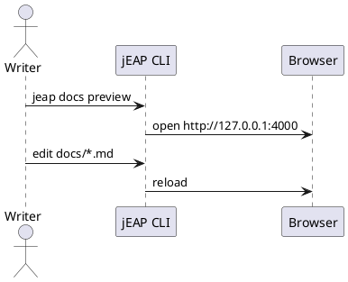
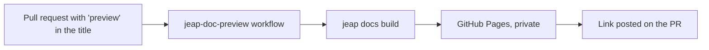
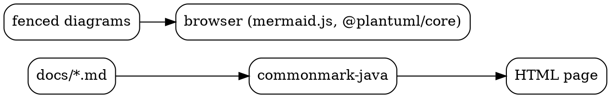

# Diagrams

## PlantUML



## Mermaid



## Graphviz



## A broken diagram

```plantuml
@startuml
Alice -> Bob : fine
this line is not PlantUML
@enduml
```

## Ordinary code

```java
System.out.println("Not a diagram");
```
